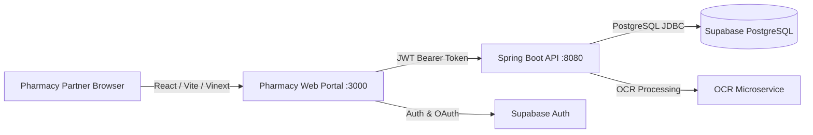

# Oath of Care Platform

The unified, security-hardened repository for the **Oath of Care** ecosystem, featuring the Pharmacy Partner Web portal, Java Spring Boot API, Supabase authentication & database migrations, and OCR integration.

---

## Architecture Overview



### Components

1. **Pharmacy Web Frontend (`/`)**
   - **Framework:** Vinext (Next.js compatibility layer on Vite 8) + React 19 + TypeScript.
   - **Styling:** Custom design system (navy, lavender/purple, ivory palette, Space Grotesk typography).
   - **Authentication:** Supabase Auth supporting Google/Facebook OAuth, email/password, and 6-digit numeric OTP verification (`EmailOtpVerification`).
   - **Features:** 6-step verified pharmacy onboarding, Leaflet interactive location picker, document upload quality checks, real-time application status tracking, inventory management with 4-tier stock levels (`HIGH_STOCK`, `MEDIUM_STOCK`, `LOW_STOCK`, `OUT_OF_STOCK`), analytics, and pharmacy profile management.

2. **Backend API (`/backend`)**
   - **Framework:** Java 21+ / Spring Boot 3.5.
   - **Security:** Spring Security Resource Server with custom `NimbusJwtDecoder` supporting `ES256`, `RS256`, and ECDSA algorithms matching Supabase rotating JWKS.
   - **Authorization:** Server-side pharmacy membership verification (`OWNER`, `MANAGER`, `STAFF`), immutable application transition guards, and structured JSON error responses.
   - **Database:** Supabase PostgreSQL with HikariCP connection pool, Row-Level Security (RLS), and zero unauthenticated data leaks.
   - **OCR Integration:** Server-to-server integration with Render OCR service for automated regulatory document extraction.

3. **Database & Security Migrations (`/supabase`)**
   - **Schema:** Strict RLS policies, automated transition triggers, audit logs, and document retention rules.
   - **Test Suite:** pgTAP regression suite covering cross-pharmacy isolation, reviewer identity verification, and document security.

---

## Local Development Quickstart

### Prerequisites
- Node.js >= 22.13.0
- Java JDK >= 21
- Apache Maven >= 3.9
- Access to Supabase project `bxjgmuvhdxlvaekpofns`

### 1. Environment Configuration

Copy the example environment files:

```bash
# Frontend
cp .env.example .env.local

# Backend
cp backend/.env.example backend/.env
```

*Fill in the development keys in `.env.local` and `backend/.env`. (These files are strictly gitignored).*

### 2. Run the Java Backend

```bash
cd backend
mvn spring-boot:run
```

The API will start on `http://localhost:8080/api/v1`.
Actuator health probe: `http://localhost:8080/actuator/health`

### 3. Run the Pharmacy Web Frontend

```bash
npm install
npm run dev
```

The portal will be available at `http://localhost:3000`.

---

## Testing & Quality Assurance

Run the complete test and verification suite:

```bash
# Frontend TypeScript check
npx tsc --noEmit

# Frontend linter
npm run lint

# Frontend production build
npm run build

# Java backend unit and security tests
mvn -f backend/pom.xml test
```

---

## Security Model

- **No Secrets in Source:** All tokens, passwords, private keys, and environment variables are excluded from version control.
- **Strict JWT Verification:** Every API endpoint validates Supabase token signature, issuer, expiry, and `authenticated` audience.
- **Server-Controlled Authorization:** User roles and pharmacy memberships are resolved exclusively from verified database records.
